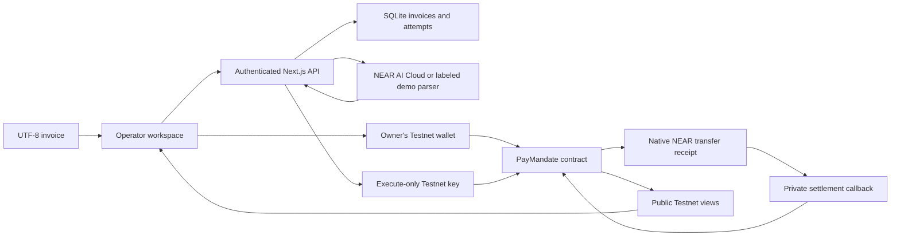
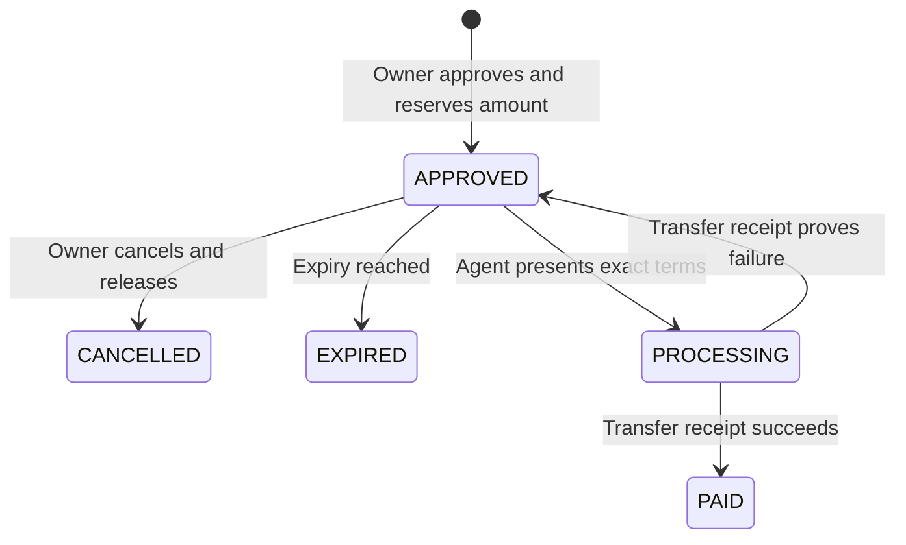

# Architecture

## Data and authority

The backend stores exact invoice bytes and the SHA-256 of those bytes, validated extracted fields, supplier names, warnings, and execution attempts. The document hash joins local invoices to their on-chain mandates. No raw invoice text is sent to the contract. Private invoice data and the agent call endpoint require the operator token. The auditor endpoint exposes on-chain fields and verified execution results from public receipts.

Cloud extraction runs server-side with a fixed endpoint, schema validation, bounded input, and a timeout. The deterministic mode reads labeled fields. The analyst has no signing or authorization tool. The operator verifies the document and edits the proposed payment fields before requesting owner-wallet approval.

## Payment lifecycle

An expired mandate cannot execute. Its owner can release its reservation once. A cancellation or an expired release clears the invoice's active index. A paid invoice keeps its index permanently. If the callback is absent or ambiguous, the stored state stays `PROCESSING`. The callback confirms the active attempt ID and requires exactly one promise result.

The backend records the signed transaction hash, contract and signer before broadcasting. A finalized receipt must identify that transaction and contain matching processing and terminal events for the same mandate attempt. An unresolved broadcast pauses further requests from that signer. If the transaction is finalized but settlement remains unknown, unrelated mandates can proceed and the affected mandate remains blocked. A crash before broadcast can leave an unresolved record. Inspect it in the Testnet explorer. If the configured contract changes, restore its prior configuration to see its journal. SQLite preserves older journal rows that lack a recorded contract and omits them from active views.

## Balance accounting

`available_yocto` comes from owner calls to `fund`. Approvals move an exact amount into `reserved_yocto`. Settlement reduces the reservation only after a successful transfer. Cancellation moves the reservation back to available. Direct transfers to the contract supply storage and operating collateral without increasing the tracked budget. The contract checks physical NEAR balance against storage cost and a 0.1 NEAR operating buffer. Approvals can pause while another transfer is settling if the funds in flight reduce physical liquidity.
